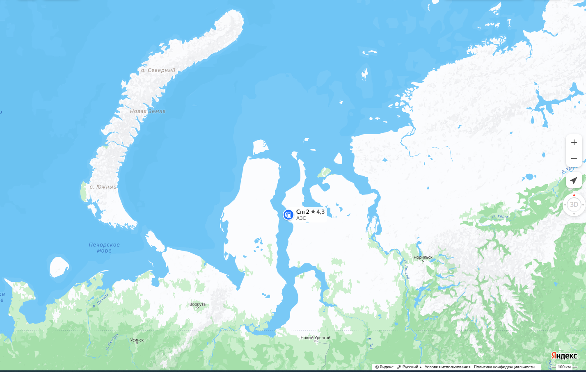
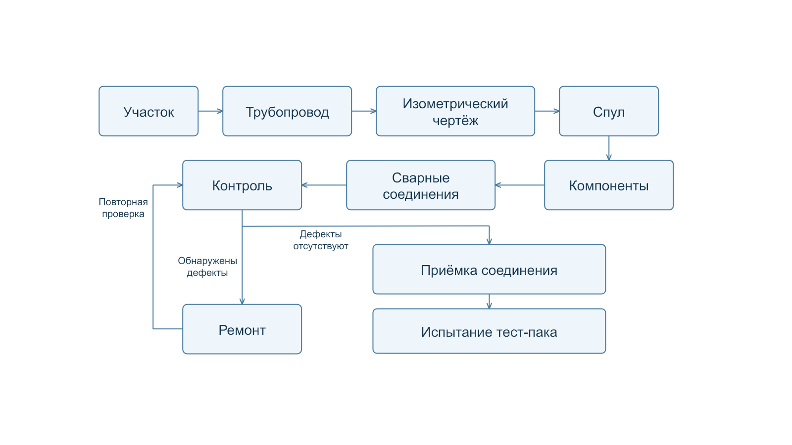

# База данных учёта изготовления трубопроводных спулов проекта «Арктик СПГ-2»

## О проекте «Арктик СПГ 2»

«Арктик СПГ 2» - проект по добыче природного газа и производству сжиженного природного газа (СПГ). Расположение: месторождение Утреннее, Гыданский полуостров, восточный берег Обской губы. Проектом предусмотрены три технологические линии общей проектной мощностью 19,8 млн тонн СПГ в год. Линии изготавливаются на основаниях гравитационного типа; работы по строительству и сборке ведутся, в частности, на площадке ЦСКМС в Мурманской области. Это описание проектных решений, а не оценка текущего выпуска продукции. [Источник: ЦСКМС](https://cskms.ru/about/).

  

<em>Карта региона проекта. Источник: Яндекс Карты. </em>

  

<em>Первая линия проекта. <a href="https://cskms.ru/about/">Источник фотографии: ЦСКМС</a>.</em>

## Описание предметной области

Проект посвящён базе данных для учёта изготовления трубопроводных спулов на примере проекта «Арктик СПГ-2». Спул - это готовый сборочный узел трубопровода, который изготавливают из отрезков труб и других компонентов по изометрическому чертежу. Спулинг - сам процесс изготовления таких узлов: подготовка деталей, сборка, сварка и контроль перед отправкой на монтаж. В состав узла могут входить трубы, фитинги, фланцы и другие детали.

Цель создания базы данных - связать сведения о трубопроводах и их узлах с данными о компонентах, сварных соединениях, исполнителях, проверках и ремонтах. Это поможет искать связанные записи и уменьшать вероятность повторной регистрации соединений и объектов. Модель не является копией производственной системы и использует условные  данные для наполнения.

Учёт спулов начинается с объектов, участков трубопровода и оборудования. Для трубопровода хранится набор изометрических чертежей.  У спула учитываются компоненты, их типы, материалы и поставки. Также хранится информация о фланцевых соединениях между компонентами спулов.

Сварное соединение связывает два различных компонента. Для него фиксируются технология и дата сварки, состояние и исполнители. Одно соединение может выполнять несколько сварщиков, а один сварщик может участвовать в изготовлении нескольких соединений. Результаты контроля и записи о ремонтах хранятся отдельно.

### Учёт изготовления трубопроводных спулов

  

  

<em>Трубопроводный спул. <a href="https://kafcoasia.com/blog/what-is-a-spool-in-piping-pipe-spooling-fabrication-guide/">Источник изображения: KAFCO Asia</a>.</em>

СУБД проекта - PostgreSQL 18.6.

### Таблицы базы данных

Ниже описаны таблицы после нормализации, реализованные в корневом [ddl.sql](ddl.sql). Преобразования исходной схемы приведены в [Normalization.md](Normalization.md).

В нормализованной схеме 28 таблиц, включая таблицы ассоциаций. Они сгруппированы по объектам, изготовлению, поставкам и испытаниям. Внутренние идентификаторы `id` используются для связей, а коды и номера помогают находить записи при заполнении базы.

| Таблица | Что хранится |
| --- | --- |
| `area` | Объекты проекта: код, название и тип. |
| `pipeline` | Трубопроводы, их назначение и категории давления и температуры. |
| `pipeline_area` | Участки трубопроводов на объектах, обогрев, минимальная требуемая толщина утеплителя `min_insulation_thickness_mm` и пассивная огнезащита для каждой пары. |
| `isometric_drawing` | Номера изометрических чертежей и связанные трубопроводы. |
| `isometric_revision` | Ревизии чертежей и даты выпуска. Номер чертежа повторяется для разных ревизий. |
| `spool` | Номер спула, используемая ревизия, объект, масса и состояние изготовления. Трубопровод определяется через ревизию и чертёж. |
| `welder` | Сварщики, табельный номер, обязательный шестизначный номер удостоверения и дата последней аттестации. |
| `welder_certificate` | Сертификаты сварщика, стандарт и срок действия. У одного сварщика может быть несколько сертификатов или ни одного. |
| `component_type` | Справочник типов компонентов: трубы, отводы, фланцы, арматура и другие элементы. |
| `material` | Справочник материалов компонентов: код марки, название материала и стандарт. |
| `insulation_material` | Справочник материалов утеплителя. |
| `cladding_material` | Справочник материалов верхнего защитного слоя и их покрытий. |
| `vendor` | Поставщики, страна, налоговый номер и контакты. Названия могут повторяться; уникальны код поставщика и пара «страна + налоговый номер». |
| `delivery` | Поставки: код, поставщик и дата. |
| `delivery_document` | Документы поставки, их типы и номера. Для одной поставки может быть несколько документов. |
| `component` | Компоненты спула, их тип, материал, поставка, размеры, масса и номер сертификата. Материал можно не указывать. |
| `component_insulation` | Утеплитель и защитный слой конкретного компонента с указанием их фактической толщины; `insulation_thickness_mm` - фактическая толщина утеплителя. |
| `weld_joint` | Сварные соединения между двумя компонентами, тип, способ сварки, дата и состояние. |
| `weld_assignment` | Связь сварщиков и выполненных ими соединений. |
| `flange_connection` | Фланцевые соединения двух компонентов, прокладка, крепёж, дата сборки и состояние. |
| `equipment` | Оборудование, его тип, объект, поставщик и состояние изготовления. |
| `inspection` | Контроль сварного соединения: метод, дата, результат, номер отчёта и описание дефекта. |
| `repair_with_inspection` | Ремонт по результатам проверки: ссылка на `inspection`, причина, описание, дата и состояние. Соединение определяется через проверку. |
| `repair_without_inspection` | Ремонт без зарегистрированной проверки: ссылка на сварное соединение, причина, описание, дата и состояние. |
| `test_package` | Пакеты испытаний: код, вид, дата и состояние. |
| `test_package_spool` | Спулы, входящие в пакет испытаний. |
| `test_package_flange_connection` | Фланцевые соединения, входящие в пакет испытаний. |
| `test_package_equipment` | Оборудование, входящее в пакет испытаний. |

Представление `welder_category` показывает `welder`, если у сварщика есть запись о сертификате, и `trainee`, если её нет. Срок действия сертификата при определении категории не учитывается.

Размеры компонентов задаются в дюймах или миллиметрах согласно имени атрибута, масса - в тоннах. `NULL` означает, что значение не указано. Например, описание дефекта может отсутствовать, если проверка пройдена.

### Значения атрибутов

Для категорий давления и температуры, состояния спула и состояния пакета испытаний допустимые значения ограничены в `ddl.sql`. Для остальных перечисленных полей в схеме используется текст без ограничения набора: ниже приведены значения, используемые в тестовых данных и операциях проекта.

| Атрибут | Значения и их смысл |
| --- | --- |
| Категория давления, `pressure_category` | `low` - низкое; `normal` - нормальное; `high` - высокое. |
| Категория температуры, `temperature_category` | `cryogenic` - криогенная; `low` - низкая; `normal` - нормальная; `high` - высокая. |
| Состояние спула, `fabrication_status` | `planned` - запланирован; `in_progress` - в работе; `under_inspection` - на контроле; `under_repair` - на ремонте; `released` - выпущен; `installed` - смонтирован; `tested` - испытан. |
| Тип сварного соединения, `weld_type` | `butt` - стыковое. |
| Способ сварки, `welding_process` | `GTAW` - аргонодуговая сварка неплавящимся электродом. |
| Состояние соединения, `weld_joint.status` | `pending` - ожидает приёмки; `accepted` - принят. |
| Метод контроля, `inspection_type` | `VT` - визуальный; `RT` - радиографический; `UT` - ультразвуковой; `PT` - капиллярный; `MT` - магнитопорошковый. |
| Результат контроля, `inspection.result` | `accepted` - принят; `rejected` - не принят. |
| Состояние ремонта, `repair_with_inspection.status`, `repair_without_inspection.status` | `planned` - запланирован; `in_progress` - выполняется; `completed` - завершён. |
| Состояние фланцевого соединения, `flange_connection.status` | `pending` - ожидает; `assembled` - собрано; `accepted` - принято. |
| Состояние оборудования, `manufacturing_status` | `fabrication` - в изготовлении; `installed` - смонтировано. |
| Вид испытания, `test_type` | `hydrostatic` - гидравлическое; `pneumatic` - пневматическое; `leak` - проверка герметичности. |
| Состояние испытания, `test_package.status` | `planned` - запланировано; `in_progress` - выполняется; `passed` - пройдено; `failed` - не пройдено. |

В пакет испытаний можно включить спулы со статусом `released`, `installed` или `tested`. Пока спул включён в пакет, его статус должен оставаться в этом наборе. Готовность к финальному испытанию проверяется отдельно по [правилам запросов](Queries.md#готовность-к-финальным-испытаниям).

Ревизия `revision` задаётся двумя цифрами, например `00`, `01` или `02`. Для одного чертежа дата более поздней ревизии не может быть раньше даты предыдущей. Номера отчётов, сертификатов и документов поставки задаются для каждой записи.

## Границы и правила

Модель охватывает участки, трубопроводы, чертежи, спулы, компоненты, поставщиков и поставки, оборудование, соединения, сварщиков, контроль, ремонты и пакеты испытаний. Финансы, складской учёт и детальное планирование в неё не входят. Оборудование учитывается отдельно по объекту и поставщику; оба поля обязательны.

Первичные и внешние идентификаторы используют `INTEGER`. В SQL заданы обязательность полей, уникальность кодов и ограничение на соединение компонента с самим собой. Ограничения SQL определяют обязательность связей, уникальность объектов и допустимость соединений.

Для регистрации фланцевого соединения процедура `register_flange_connection` допускает компоненты типов `FLG-WN`, `FLG-BL`, `VLV-*`, `STRAINER`, `EXP-JOINT` и `ORIFICE`. В рамках проекта они считаются фланцевыми. Проверка выполняется только при вызове процедуры; прямой `INSERT` её не вызывает. Связь с отдельной таблицей `equipment` этим правилом не задаётся.

Трубопровод может проходить через несколько объектов, а через один объект могут проходить разные трубопроводы. Для этого используется таблица `pipeline_area`, где пара `pipeline_id` и `area_id` определяет участок конкретной линии. Для этой пары отдельно указываются наличие обогрева, толщина изоляции в миллиметрах и наличие пассивной огнезащиты. Ноль означает, что минимальная толщина утеплителя для участка не установлена; ненулевая толщина задаётся кратной 20 мм. Для компонента, у которого внесена изоляция, фактическая толщина утеплителя должна быть не меньше минимальной толщины его участка. Отсутствие записи об изоляции не подтверждает её отсутствие и отдельно не запрещено. У трубопровода должно быть не менее двух участков; это проверяется при завершении транзакции.

## Модели базы данных

[Сущность-связь и физическая модель](ALNG2_models.drawio) находятся на двух вкладках одного файла draw.io. ERM описывает сущности и их связи, PDM - таблицы, типы данных и ключи.

- [Изображение ERM](ALNG2_models_ERM.drawio.png)
- [Изображение PDM](ALNG2_models_PDM.drawio.png)

## Файлы проекта

- [Functionla_dependencies.md](Functionla_dependencies.md) - атрибуты, ФЗ, кандидатные ключи и неприводимые множества исходной схемы до нормализации.
- [Normalization.md](Normalization.md) - нормализация, декомпозиции и итоговая логическая схема.
- [Queries.md](Queries.md) - 12 неагрегирующих и 5 агрегирующих запросов: параметры, результаты и правила расчётов.
- [Views.md](Views.md) - шесть представлений и их выходные атрибуты.
- [Modifications.md](Modifications.md) - шесть модифицирующих операций и их входные параметры.
- [Indexes.md](Indexes.md) - семь дополнительных индексов, их типы и назначение.
- [Procedures.md](Procedures.md) - семь хранимых процедур, их параметры и составные типы.
- [ddl.sql](ddl.sql) - определения 28 таблиц, ключей, последовательности ремонта и ограничений.
- [insert.sql](insert.sql) - тестовые данные. Некоторые реквизиты и номера документов вымышлены.
- [select.sql](select.sql) - запросы на получение данных и представления.
- [update.sql](update.sql) - модифицирующие запросы, проверки и триггеры, дополнительные индексы, составные типы и хранимые процедуры.
- [befor_noramalization](befor_noramalization/) - SQL исходной схемы до нормализации.

В пустой базе выполнить `ddl.sql`, затем `insert.sql`, `update.sql` и `select.sql`. Тестовые данные загружаются один раз; `update.sql` подключает дополнительные проверки и остальные объекты, а `select.sql` выполняет примеры выборок и создаёт представления. Значения в блоках `parameters` служат примерами входных параметров.

## Источники

- [«Арктик СПГ 2»: завод СПГ и СГК](https://arcticspg.ru/proekt/zavod-spg-i-sgk/)
- [ЦСКМС: о проекте и технологических линиях](https://cskms.ru/about/).
- [What is a Spool in Piping?](https://kafcoasia.com/blog/what-is-a-spool-in-piping-pipe-spooling-fabrication-guide/)
